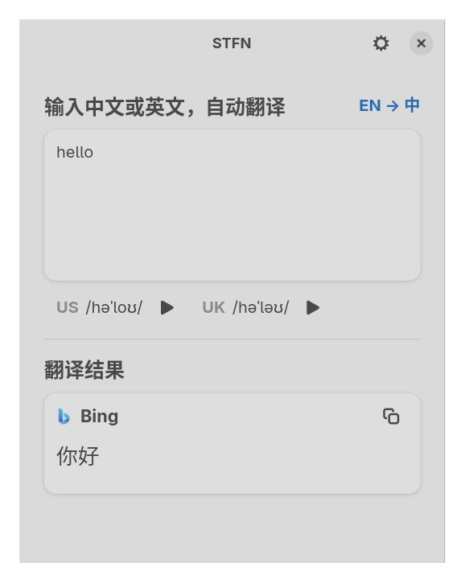
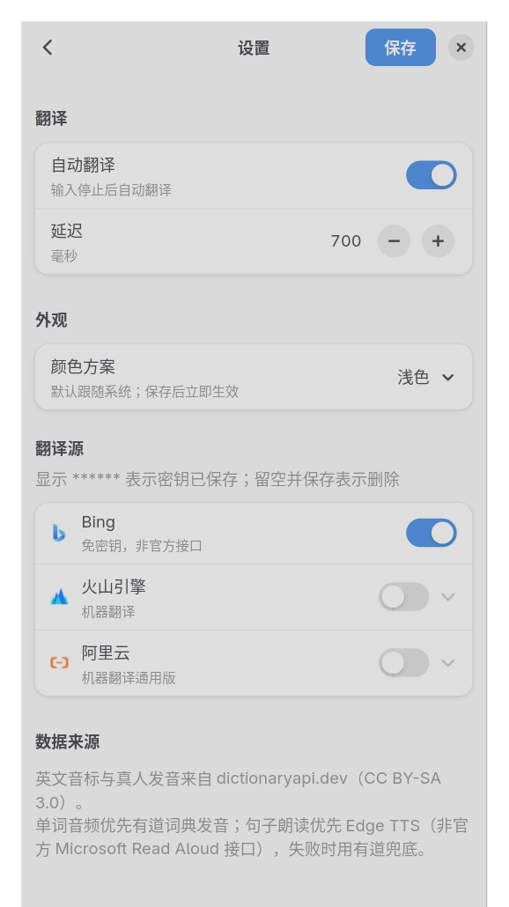

# STFN — Simple Translator For Niri

在 [niri](https://github.com/YaLTeR/niri) 里随手可用的中英翻译工具。打开窗口输入即译；英文单词有 US/UK 音标和发音；选中文本按快捷键就能翻译。

[](https://github.com/rain7831/stfn/actions/workflows/ci.yml)
[](LICENSE)

当前版本：**v0.2.0** · [版本说明](docs/versions/v0.2.0.md) · [Releases](https://github.com/rain7831/stfn/releases)

| 主界面 | 设置页 |
| :---: | :---: |
|  |  |

## 为什么用它

- **打开就能用**：默认 Bing 免密钥，零配置即可中英互译。
- **niri 原生**：普通平铺窗口，app-id 固定为 `stfn`，方便写 niri 规则和快捷键。
- **输入舒服**：多行输入、自动翻译、fcitx5 / text-input-v3 候选框正常。
- **单词会读**：英文单词显示 US/UK IPA，可播放真人音频；没有真人音频时自动兜底。
- **句子也能读**：不是单词时提供“朗读原文/朗读译文”，整句朗读。
- **选中即译**：在任意应用选中文本，按快捷键打开 STFN，自动填入并翻译。
- **轻量**：Rust 单二进制；不常驻后台、不保存历史、不写磁盘缓存。

## 安装

### Arch Linux（推荐）

从源码构建：

```bash
sudo pacman -S --needed base-devel rust gtk4 libadwaita alsa-lib
git clone https://github.com/rain7831/stfn.git
cd stfn
cargo build --release
sudo install -Dm755 target/release/stfn /usr/local/bin/stfn
```

也可以安装到用户目录：

```bash
cargo install --path .
# 确保 ~/.cargo/bin 在 PATH 中
```

预编译包见 [Releases](https://github.com/rain7831/stfn/releases)（Arch Linux x86_64）；AUR 打包待发布。

### 其他 Linux

需要 GTK 4.22+、libadwaita 1.9+，以及 PipeWire 或 PulseAudio。当前只在 Arch Linux + niri 上开发和验证；其他 Wayland 桌面可以尝试，但不保证一致。

## 开始使用

### 打开翻译窗口

```bash
stfn
```

每次启动都是新进程和新窗口，关闭窗口即退出；没有托盘，也不会复用旧窗口。

在 niri 里建议绑定 `Mod+Shift+T`：

```kdl
binds {
    Mod+Shift+T { spawn "stfn"; }
    Mod+Shift+Y { spawn "stfn" "selection"; }
}
```

### 输入与快捷键

- 直接输入中文或英文，停顿约 700ms 自动翻译。
- `Ctrl+Enter`：立即翻译，不等自动翻译。
- `Enter`：换行；输入框支持多行。
- `Esc`：有内容时清空；为空时关闭窗口。
- `Ctrl+L`：重新聚焦输入框。
- `Ctrl+,`：打开设置页。

输入框上方会显示检测到的方向，例如 `EN → 中`。

### 听发音和朗读

- **英译中**：输入单个英文单词时，输入卡片下方显示 `US /.../ ▶` 和 `UK /.../ ▶`。
- **中译英**：每个翻译结果卡片在厂商标题下方显示该译文的音标和播放按钮。
- 词典没有真人音频时，会依次尝试有道词典发音、Edge TTS；播放失败会保留按钮，可以再点一次。
- 非单词的英文文本（句子、短语）会显示“朗读原文/朗读译文”，使用 Edge TTS 整句朗读；失败时用有道兜底。
- 音频在单词显示后自动预加载，点击时通常已就绪；音频只缓存在内存，不会占用磁盘。

播放需要系统音频正常。如果听不到声音，先确认 PipeWire/PulseAudio 的默认输出和音量。

### 翻译选中的文本

在 niri 中选中任意应用的文本，按 `Mod+Shift+Y`（需要先添加上面的绑定）：

```bash
stfn selection
```

STFN 会读取 Wayland 的 primary selection，把文本填入输入框、聚焦并立即翻译。

- 只读取 primary selection，不会覆盖普通剪贴板。
- 读不到选区时会提示，不会回退读取旧剪贴板，也不会模拟 `Ctrl+C`。
- 选区超过 5000 字符会直接拒绝，不填入、不翻译。
- primary selection 由应用主动设置；部分 Electron/特殊应用可能不支持。

### 设置

打开设置页的三种方式：

- 主窗口右上角齿轮；
- 快捷键 `Ctrl+,`；
- 命令行 `stfn settings`（新进程打开设置页）。

设置页支持：

- 自动翻译开关和输入延迟（200–2000ms）。
- Bing / 火山引擎 / 阿里云的启用与密钥。
- 外观：跟随系统 / 浅色 / 深色，保存后立即生效。
- 已保存的密钥显示为 `******`；不改动保留，清空保存删除，输入新值替换。
- 修改未保存就返回或关闭窗口，会弹出确认。

手动主题会覆盖系统生成的静态 GTK 调色板（例如 Noctalia 的 `noctalia.css`）；选择“跟随系统”会恢复系统主题。

## 命令行

GUI 和 CLI 共用同一套翻译源，CLI 不会初始化 GTK。

```bash
stfn hello                 # 翻译并输出
stfn --to en 你好           # 强制目标语言
stfn --source all hello    # 使用所有已启用翻译源
stfn --json hello          # JSON 输出，便于脚本
stfn --notify hello        # 结果发送到桌面通知
stfn --speak 你好           # 朗读英文译文（默认 US）
echo hello | stfn -        # 从 stdin 读取
```

- 退出码：`0` 成功，`1` 运行时失败，`2` 用法/输入错误。
- `--json` 的 `phonetic` 会对英文单词填 IPA；未命中或非单词为 `null`。
- `--speak` 只朗读英文译文；中文目标返回 1。TTS 不可用时提示并返回 1。
- `stfn selection` 是 GUI 启动意图，不输出 stdout。

完整参数见 [`docs/tech/cli.md`](docs/tech/cli.md)。

## niri 配置

推荐绑定：

```kdl
binds {
    Mod+Shift+T { spawn "stfn"; }
    Mod+Shift+Y { spawn "stfn" "selection"; }
}

window-rule {
    match app-id="^stfn$"
    default-column-width { proportion 0.25; }
}
```

初始宽度为屏幕的 1/4；需要时用 `Mod+R` 或拖拽调宽。

如果更喜欢悬浮窗口，可以再添加：

```kdl
window-rule {
    match app-id="^stfn$"
    open-floating true
    default-floating-position x=0 y=0 relative-to="top"
    default-column-width { proportion 0.25; }
    default-window-height { proportion 0.6; }
}
```

## 配置与密钥

配置文件位置：

```text
$XDG_CONFIG_HOME/stfn/config.toml
# 默认 ~/.config/stfn/config.toml
```

首次启动会自动生成。常用配置：

```toml
[general]
auto_translate = true
debounce_ms = 700
target = "auto"          # auto | zh | en
default_source = "bing"
color_scheme = "default" # default | light | dark

[providers.bing]
enabled = true

[providers.volcengine]
enabled = false

[providers.alibaba]
enabled = false
```

- 只有 `enabled = true` 的平台会出现在结果区。
- 火山/阿里需要密钥；密钥不写入 `config.toml`。
- 密钥优先存储在系统 Secret Service（gnome-keyring 等）；不可用时，需在设置页明确允许后写入 `0600` 的 `credentials.toml`。
- 环境变量优先级最高，适合脚本或不想落盘密钥的场景：

```bash
export STFN_VOLC_ACCESS_KEY="..."
export STFN_VOLC_SECRET_KEY="..."
export STFN_ALI_ACCESS_KEY_ID="..."
export STFN_ALI_ACCESS_KEY_SECRET="..."
```

完整说明见 [`docs/tech/config.md`](docs/tech/config.md)。

## 常见问题

### Bing 用不了 / 翻译失败

Bing 是免密钥的非官方网页接口，没有 SLA，接口变化或网络限制都可能导致失败。可以在设置页启用火山引擎或阿里云作为替代。

### 音标不显示

音标只对**单个英文单词**显示，句子和短语不会显示 IPA。词典查询需要网络；查不到、非单词或词典服务暂时不可用时不会占位。此时英文句子仍可以使用“朗读原文/朗读译文”。

### 没有声音

STFN 通过 PipeWire/PulseAudio 播放。请先确认系统默认输出、静音状态和音量；可以先用 `stfn --speak 你好` 做一次简单测试。Edge TTS 偶发限流时会自动重试并使用有道兜底。

### 改了颜色方案没有变化

设置页的修改需要点击“保存”或按 `Ctrl+S`。手动模式会覆盖系统静态 GTK 调色板；如果选择“跟随系统”，则重新交给系统主题（例如 Noctalia）管理。

### 打开多个窗口 / 关闭后没有后台进程

这是 v0.2 的设计：每次启动独立进程和窗口，关闭即退出，不常驻后台。

### 选区翻译读不到文本

STFN 只读 primary selection，不读普通剪贴板。请先在支持 primary selection 的应用中选中文本；部分 Electron/特殊应用可能不设置 primary selection。

## 隐私与数据来源

- 不保存翻译历史，不做遥测，不落盘翻译内容。
- 输入会发送到你启用的翻译平台（Bing / 火山 / 阿里）。
- 英文单词查询会发送给 dictionaryapi.dev。
- 单词发音会请求有道词典；仍然失败时会使用 Edge TTS（非官方 Microsoft Read Aloud 接口）。
- 句子朗读使用 Edge TTS，失败时用有道兜底。
- 音标和音频只缓存在内存，退出即清空，不产生磁盘缓存文件。
- Bing 为社区常用的非官方接口；Bing、火山、阿里、有道和 Edge TTS 都可能随时变化。

数据来源：

- 英文音标与真人音频：[dictionaryapi.dev](https://dictionaryapi.dev/)，CC BY-SA 3.0（音频 CC BY / BY-SA）。
- 单词音频兜底：有道词典发音（`dict.youdao.com/dictvoice`）。
- 句子/最终兜底：Edge TTS（非官方 Microsoft Read Aloud 接口）。
- 厂商 logo 来自各厂商品牌资源或 Simple Icons；商标归各自所有者。

## 开发

- 设计与技术文档：[`docs/tech/`](docs/tech/)
- 版本说明：[`docs/versions/`](docs/versions/)
- 语言：Rust；MSRV 见 `Cargo.toml`。
- 系统依赖：GTK 4.22+、libadwaita 1.9+、ALSA（rodio）。

常用检查：

```bash
cargo fmt --check
cargo clippy --all-targets -- -D warnings
cargo test
cargo build --release
```

CI 在 Arch Linux 容器中运行上述 fmt/clippy/test/build；打 `v*` 标签会触发 release workflow，构建并上传 `stfn-<tag>-x86_64-linux.tar.gz`。

## License

MIT，见 [`LICENSE`](LICENSE)。
